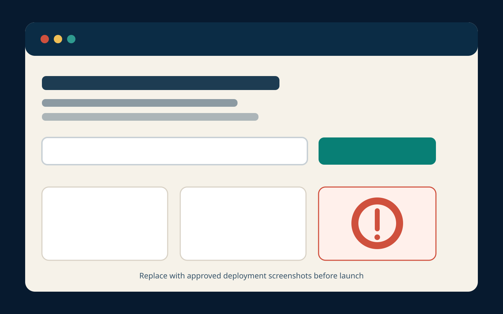

# Website Risk Checker

Website Risk Checker is an educational web application associated with **Teens Against Scams**. A
visitor can enter a publicly accessible website URL and receive a careful assessment of limited,
observable risk indicators from configured threat-intelligence lookups and passive technical
checks.

> **This project identifies observable risk signals. It does not determine guilt, intent,
> legality, safety, or trustworthiness.**

Automated results may be incomplete, outdated, or incorrect. A low score does not guarantee that a
website is safe, and a high score does not prove fraud, illegality, malicious intent, ownership, or
criminal conduct.

## Screenshot



Replace this placeholder with approved deployment screenshots before launch. Do not include real
API keys, private URLs, active malicious URLs, or personal information.

## What the first release does

- Accepts only public `http` and `https` addresses.
- Removes URL query strings and fragments before display, logging, caching, or provider lookup.
- Rejects embedded credentials, internal names, private/reserved addresses, nonstandard ports, and
  unsafe redirects.
- Re-resolves and validates DNS before a destination connection, then pins the validated address.
- Uses a limited `HEAD` request and optional TLS handshake; it does not execute page JavaScript or
  download page content.
- Normalizes provider results behind one TypeScript interface.
- Makes provider failures, missing keys, stale results, and quota exhaustion score-neutral.
- Keeps scan results in browser-tab session storage rather than a public or server-side history.
- Separates live and demonstration modes; demo cases use reserved domains and local fixtures.
- Publishes a transparent, versioned scoring file at
  [`config/scoring-rules.json`](config/scoring-rules.json).
- Includes a private correction-email workflow that generates a reference without storing the form.

It is a reputation and risk-indicator tool—not a vulnerability scanner. It never performs port
scanning, login attempts, form submissions, directory discovery, CAPTCHA bypass, exploit testing,
file download, malware execution, browser automation on submitted sites, or access-control bypass.

## Provider compliance snapshot

The table is an engineering record, not legal advice. Terms and quotas can change. Every operator
must review the linked official pages before enabling a provider and at least every 90 days
afterward. The review below was performed on **2026-07-30**.

| Provider              | Purpose                                                              | Free key required             | Noncommercial restriction                                                           | Typical quota (verified 2026-07-30)                                              | URL submission behavior                                       | Privacy concern                                                                                                    | Enabled by default | Official documentation                                                                                                                          | Last verified |
| --------------------- | -------------------------------------------------------------------- | ----------------------------- | ----------------------------------------------------------------------------------- | -------------------------------------------------------------------------------- | ------------------------------------------------------------- | ------------------------------------------------------------------------------------------------------------------ | ------------------ | ----------------------------------------------------------------------------------------------------------------------------------------------- | ------------- |
| Google Safe Browsing  | Known social-engineering, malware, and unwanted-software URL matches | Yes                           | Yes; free Safe Browsing API is noncommercial                                        | Default project quota; inspect the current allocation in Google Cloud Console    | Lookup only; never requests a new scan                        | Google states that submitted URLs and associated data may be used and shared                                       | No                 | [v5 reference](https://developers.google.com/safe-browsing/reference), [terms](https://developers.google.com/safe-browsing/terms)               | 2026-07-30    |
| URLhaus               | Known malware-distribution URLs                                      | Yes                           | Community fair use; commercial or for-profit needs may require paid enhanced access | Fair use; fixed individual-query quota not publicly promised                     | Lookup only; no malware URL submission                        | Redacted lookup URL is disclosed; community data has its own terms                                                 | No                 | [Community API](https://urlhaus.abuse.ch/api/)                                                                                                  | 2026-07-30    |
| PhishTank             | Community phishing database                                          | Yes for practical rate limits | Official terms permit commercial API data use                                       | Dynamic hourly limit returned in response headers; HTTP 509 indicates over limit | Lookup only; no report submission                             | Redacted lookup URL is disclosed; community submissions may contain errors                                         | No                 | [API](https://phishtank.org/api_info.php), [terms](https://phishtank.org/terms.php)                                                             | 2026-07-30    |
| LevelBlue Labs OTX    | Community threat-intelligence pulses                                 | Yes                           | Yes; OTX is free to end users for noncommercial use                                 | No fixed public number found; monitor current account terms and response headers | Indicator lookup only; no content submission                  | OTX terms permit submitted content to be retained, used, and distributed; this project avoids submission endpoints | No                 | [DirectConnect](https://otx.alienvault.com/api), [OTX EULA](https://www.levelblue.com/legal/otx-eula-terms)                                     | 2026-07-30    |
| VirusTotal Public API | Existing aggregated URL analysis reports                             | Yes                           | Yes; Public API is noncommercial and not for business workflows                     | 4 requests/minute and 500/day                                                    | Existing-report lookup only; no URL rescan and no file upload | URL identifier is requested; new submissions would be shared, so they are disabled                                 | No                 | [Public vs Premium](https://docs.virustotal.com/reference/public-vs-premium-api), [URL reports](https://docs.virustotal.com/reference/url-info) | 2026-07-30    |

The full machine-readable review is
[`config/provider-compliance.json`](config/provider-compliance.json). It records attribution,
retention, caching, submission-privacy, review-date, and operator notes for every adapter.

### Noncommercial-use warning

`PROJECT_USE_MODE=noncommercial` is the default. Google Safe Browsing, OTX, and VirusTotal Public API
are restricted to noncommercial use. URLhaus community access may require a commercial agreement
for commercial or for-profit use. Restricted adapters refuse commercial mode.

Adding advertising, paid subscriptions, paid access, sponsorship arrangements, data sales, or
other revenue may change eligibility even if the project remains educational or nonprofit-style.
Before any monetization:

1. disable restricted adapters;
2. obtain written permission or an appropriate plan directly from each provider;
3. review privacy, attribution, and redistribution obligations;
4. update the compliance file and public disclosure.

The application never switches to a paid provider or evades limits automatically.

## Architecture

```text
Browser form
   │  public URL only; warning shown before submit
   ▼
Next.js route handler ── application rate limit + same-origin check
   │
   ├── normalize and redact ── remove query/fragment; reject credentials/ports
   │
   ├── DNS safety gate ── reject private/reserved targets
   │
   ├── passive checker ── DNS recheck + pinned HEAD + redirect validation + TLS
   │
   └── provider adapters ── fixed official endpoints; lookup only; bounded JSON
              │
              ▼
      normalized evidence ── transparent scoring ── device-local result page
```

See [`docs/ARCHITECTURE.md`](docs/ARCHITECTURE.md) and
[`docs/THREAT_MODEL.md`](docs/THREAT_MODEL.md) for security boundaries and tradeoffs.

## Repository structure

```text
app/                         Next.js pages and server route handlers
components/                  Accessible UI components
config/                      Scoring and provider compliance records
docs/                        Architecture, deployment, threat model, checklists
lib/analysis/                Local heuristics, orchestration, transparent scoring
lib/providers/               Independent provider adapters and schemas
lib/security/                SSRF defenses, rate limits, redaction, bounded requests
tests/                       Unit, integration, fixtures, and Playwright tests
.github/                     CI, CodeQL, Dependabot, templates, policy files
```

No database is necessary for the initial privacy-minimizing release, so Prisma and SQLite are
intentionally not included. If durable correction storage is added later, use Prisma with SQLite
for local development only and select a production-grade managed database for deployed
environments. Document retention, encryption, deletion, authorization, migrations, and legal basis
before enabling storage.

## Local setup

Requirements:

- Node.js 24 or later
- pnpm 11 or later (Corepack is recommended)
- no real provider keys are needed for demo mode or tests

```bash
git clone https://github.com/YOUR-ORG/website-risk-checker.git
cd website-risk-checker
corepack enable
pnpm install --frozen-lockfile
cp .env.example .env
pnpm dev
```

Open [http://localhost:3000](http://localhost:3000). For a completely local, network-free product
demonstration, set `APP_MODE=demo` in `.env`.

### Environment variables

| Variable                           | Required             | Purpose                                                                     |
| ---------------------------------- | -------------------- | --------------------------------------------------------------------------- |
| `APP_MODE`                         | Yes                  | `live` or `demo`; demo accepts only built-in example cases                  |
| `PROJECT_USE_MODE`                 | Yes                  | `noncommercial` or `commercial`; restricted adapters refuse commercial mode |
| `APP_BASE_URL`                     | Production           | Exact public origin used for same-origin checks and metadata                |
| `ENABLE_*`                         | Per provider         | Explicit opt-in for each provider; all are `false` by default               |
| `*_API_KEY` / `URLHAUS_AUTH_KEY`   | Per enabled provider | Server-only credential; never prefix with `NEXT_PUBLIC_`                    |
| `STRICT_PROVIDER_TERMS`            | Recommended          | Refuse an overdue provider in strict mode                                   |
| `PROVIDER_REVIEW_MAX_AGE_DAYS`     | No                   | Maximum review age before a warning; default 90                             |
| `APP_RATE_LIMIT_*`                 | Yes                  | Per-instance abuse limit; use shared storage for multi-instance production  |
| `PROVIDER_MAX_RETRIES`             | No                   | Bounded retry count for timeouts, network failures, and HTTP 5xx; default 1 |
| `PROVIDER_RETRY_BASE_MS`           | No                   | Initial exponential-backoff delay; default 250 ms                           |
| `TRUST_PROXY`                      | Production-dependent | Trust `X-Forwarded-For` only behind a configured trusted proxy              |
| `RATE_LIMIT_HASH_SECRET`           | Production           | At least 32 random characters, used to HMAC short-lived rate-limit keys     |
| `CORRECTION_EMAIL`                 | Pre-launch           | Private inbox used by the correction workflow                               |
| `PRIVACY_EMAIL` / `SECURITY_EMAIL` | Pre-launch           | Private operator contacts                                                   |
| `LEGAL_CONTACT`                    | Pre-launch           | Operator-supplied legal contact text                                        |

Review every value in [`.env.example`](.env.example). Never commit `.env`.

## Obtaining free access

Use only official provider pages. No key is required to build, test, or run demo mode.

- **Google Safe Browsing:** follow the official
  [getting-started guide](https://developers.google.com/safe-browsing/v4/get-started) and current
  [v5 reference](https://developers.google.com/safe-browsing/reference). Confirm noncommercial
  eligibility and current quota before enabling.
- **URLhaus:** create a free Auth-Key through the
  [official Community API page](https://urlhaus.abuse.ch/api/). Confirm fair-use eligibility.
- **PhishTank:** complete free registration and retrieve the application key described in the
  [official FAQ](https://phishtank.org/faq.php). Respect rate-limit response headers.
- **OTX:** create an OTX account and obtain the DirectConnect key from the
  [official API page](https://otx.alienvault.com/api). Confirm noncommercial eligibility.
- **VirusTotal:** obtain the Community API key described in
  [Getting started](https://docs.virustotal.com/reference/getting-started). The Public API cannot be
  used commercially and cannot be multiplied across accounts to bypass limits.

Do not enter a credit card, activate a paid trial, or accept a paid plan merely to satisfy this
repository. If a provider's free path or eligibility changes, leave the adapter disabled and update
the compliance record. Provider pricing and signup requirements can change at any time.

## Live mode and demonstration mode

### Live mode

`APP_MODE=live` accepts public URLs, performs the local safety gate, lists every provider status, and
uses real timestamps. A missing key returns `NOT_CONFIGURED`; it never triggers fake results or a
lower score.

### Demonstration mode

`APP_MODE=demo`:

- shows a persistent simulated-data banner on every page;
- blocks `/api/analyze`;
- accepts only built-in case IDs at `/api/demo`;
- uses reserved `.test` names and mocked provider data;
- performs no live provider or destination requests.

The `/demo` page is also available in live deployments and remains clearly labeled.

## Scoring

The four cautious categories are:

- 0–24: **Lower observed risk**
- 25–49: **Some caution recommended**
- 50–74: **Elevated observed risk**
- 75–100: **Strong warning indicators**

Strong current database matches carry more weight than local formatting heuristics. All weak
heuristics combined are capped at 24 points, so they cannot independently create an elevated or
maximum-risk result. Errors and unavailable sources always contribute zero.

Read [`SCORING.md`](SCORING.md) and
[`config/scoring-rules.json`](config/scoring-rules.json) before changing any weight. Scoring changes
require tests, false-positive analysis, a version bump, and documentation.

## Testing and quality checks

All automated tests use mocked providers, local fixtures, reserved example domains, and test DNS
resolvers. They never visit a live phishing, scam, malware, or exploit site.

```bash
pnpm format:check
pnpm lint
pnpm typecheck
pnpm test:unit
pnpm test:integration
pnpm build
pnpm test:e2e:install
pnpm test:e2e
pnpm audit
```

Run the common non-browser checks together with `pnpm check`. Playwright installs a browser
separately and is intentionally not hidden inside the build script.

## Docker

```bash
cp .env.example .env
docker compose build --pull
docker compose up
```

Open [http://localhost:3000](http://localhost:3000). The final image runs as an unprivileged user,
drops Linux capabilities, uses a read-only root filesystem in Compose, and includes a health check.

Stop it with:

```bash
docker compose down
```

## Deployment

GitHub should host the source repository, not the live server application. A live deployment
requires server-side route handlers and secret storage, so GitHub Pages is not the primary
deployment target. A static Pages build, if added later, must be a clearly labeled demo with no
keys.

Use a server-capable platform or container host and follow
[`docs/DEPLOYMENT.md`](docs/DEPLOYMENT.md). At minimum:

1. review current provider terms and free/noncommercial eligibility;
2. configure only approved provider keys in the platform's secret manager;
3. set the exact HTTPS `APP_BASE_URL`;
4. use a shared rate limiter for multi-instance deployment;
5. isolate outbound checks with network egress controls where possible;
6. configure private correction, privacy, and security contacts;
7. test SSRF, DNS rebinding, redirects, quotas, errors, and secret redaction;
8. complete attorney review of legal documents;
9. enable dependency updates, CodeQL, secret scanning, and branch protection.

## Privacy design

- No accounts, profiles, advertising trackers, public comments, or public scan history.
- No permanent scan storage in this release.
- Query strings and fragments are discarded early.
- Results remain in tab-scoped browser session storage until cleared or the tab closes.
- Provider-cache keys are one-way hashes; values expire in memory where provider terms allow.
- Raw IP addresses are not kept as rate-limit keys.
- Unknown URLs are never submitted for new analysis.
- Correction forms create a private mail draft and are not stored by the app.

Read [`PRIVACY.md`](PRIVACY.md). Operators must update it for their actual host, logs, subprocessors,
jurisdiction, and retention behavior.

## Security design

Security controls include Zod input and provider schemas, output encoding through React, CSP and
secure headers, same-origin checks on POST routes, size and time limits, structured log redaction,
server-only secrets, per-user application limits, per-provider request counters and queues, bounded
exponential backoff, manual redirects, DNS rechecks, IP-range rejection, address pinning, and safe
error messages. The built-in VirusTotal queue also stops at its documented 500-request daily limit;
HTTP 429/509 responses from any provider stop further work and remain score-neutral.

Read [`SECURITY.md`](SECURITY.md) and [`docs/THREAT_MODEL.md`](docs/THREAT_MODEL.md). SSRF defense is
layered but cannot guarantee perfect protection; production egress isolation is still recommended.

## Correction process

Every result links to `/corrections`. An owner or authorized representative can request:

- a fresh automated check;
- review of a potentially inaccurate or expired result;
- acknowledgement that a previously compromised site was repaired;
- deletion of unnecessarily retained information.

The app generates a reference and a private email draft. It does not publish disputes or store the
form, and it does not promise that a request will change the score. Configure `CORRECTION_EMAIL`
before launch. Never direct corrections to public GitHub issues.

## Legal documents

The repository includes `DISCLAIMER.md`, `TERMS.md`, and `PRIVACY.md` as careful technical drafts.
They require attorney review before public launch, especially:

- operator identity and contact information;
- effective dates;
- governing law and dispute resolution;
- indemnification language;
- warranty and liability limitations;
- laws applying to children, nonprofits, cybersecurity services, and privacy;
- each provider's API/data terms and required attribution.

No technical design, disclaimer, open-source license, terms document, or privacy policy can
guarantee zero liability. Do not claim that the project is “lawsuit-proof.”

## Contributing

Read [`CONTRIBUTING.md`](CONTRIBUTING.md) and
[`CODE_OF_CONDUCT.md`](CODE_OF_CONDUCT.md). In particular:

- do not add an individual website to a blacklist based on suspicion;
- do not commit active malicious URLs, personal information, or real secrets;
- use reserved domains and mocked responses in tests;
- document provider terms and false-positive risk;
- report vulnerabilities privately.

## GitHub repository setup

After creating an empty GitHub repository:

```bash
git init
git add .
git commit -m "Initial Website Risk Checker release"
git branch -M main
git remote add origin https://github.com/YOUR-ORG/website-risk-checker.git
git push -u origin main
```

Then:

1. protect `main` and require the CI and CodeQL checks;
2. require at least one review and conversation resolution;
3. enable private vulnerability reporting;
4. enable secret scanning and push protection where available;
5. enable Dependabot security updates;
6. disallow Actions from accessing production secrets on forked pull requests;
7. add repository topics and replace operator placeholders;
8. perform the [pre-launch checklist](docs/PRE_LAUNCH_CHECKLIST.md).

## License and third-party material

Source code is available under the [MIT License](LICENSE). The MIT License does **not** replace
website terms, privacy disclosures, third-party API terms, data licenses, responsible operation,
security safeguards, or attorney review. Open-source licensing does not eliminate liability.

Provider data and provider names are governed by their own terms and are not relicensed under MIT.
See [`THIRD_PARTY_NOTICES.md`](THIRD_PARTY_NOTICES.md).

## Roadmap

- Independent security review and SSRF-focused penetration test.
- Operator-approved production rate-limit backend.
- Optional privacy-preserving Safe Browsing local-list mode after a separate review.
- Translation workflow reviewed for accuracy and accessible reading level.
- Moderated, private correction case management with explicit retention and deletion controls.
- Periodic automated reminders for provider-terms review.

Public accusation boards, user-scored blacklists, vulnerability scanning, unknown-URL submission,
file analysis, and public scan histories are explicitly out of scope.

## Maintainer checklist

- [ ] Re-review every provider's official terms, quota, pricing, attribution, and privacy behavior.
- [ ] Confirm noncommercial eligibility and keep `PROJECT_USE_MODE` truthful.
- [ ] Disable any adapter whose terms changed or cannot be confirmed.
- [ ] Replace all operator, contact, jurisdiction, date, and deployment placeholders.
- [ ] Complete attorney review of legal documents.
- [ ] Run format, lint, typecheck, unit, integration, build, E2E, audit, and container checks.
- [ ] Test private/reserved IPs, DNS rebinding, redirect-to-internal targets, and timeouts.
- [ ] Configure trusted proxy behavior, shared application limits, and provider quotas.
- [ ] Verify secrets never reach browser bundles, logs, errors, screenshots, or CI artifacts.
- [ ] Confirm correction requests stay private and retention disclosures match reality.
- [ ] Enable branch protection, CodeQL, dependency review, Dependabot, and secret scanning.
- [ ] Record the completed review in `config/provider-compliance.json` and `CHANGELOG.md`.
